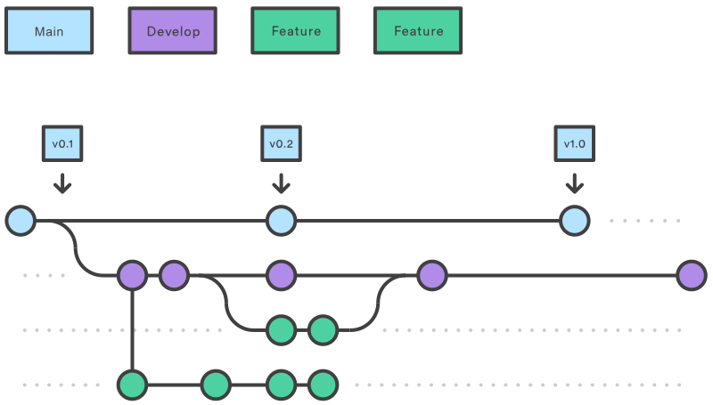
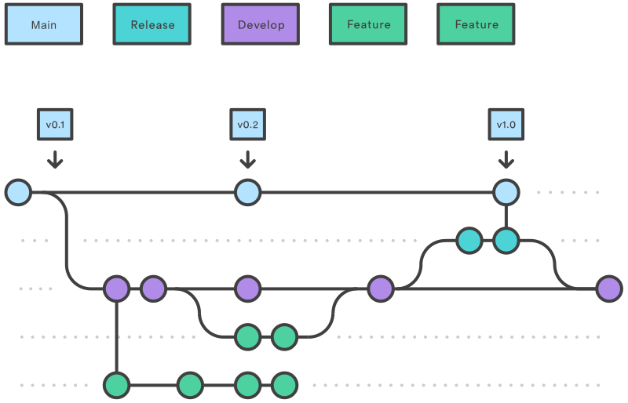
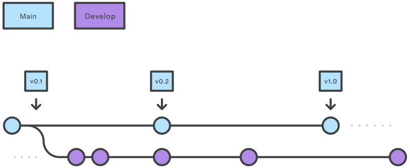

# 📖 Guia de contribuição - Agend.ae

> **📅 Agend.ae**   
> Agenda ae pae, modus operandi e produtivo

> [!TIP]
> Este guia foi idealizado para ajudar o desenvolvimento da equipe, portanto, está totalmente aberto a sugestões.

### 📌 Sumário

- [Resumo em 5 passos](#-resumo-em-5-passos)
- [Palavras que vão aparecer](#-palavras-que-vão-aparecer)
- [Branches](#-branches)
- [Commits](#-commits)
- [Verificações antes do PR](#-verificações-antes-do-pr)
- [Pull Request e revisão](#-pull-request-e-revisão)
- [Para quem já tem experiência](#-para-quem-já-tem-experiência)
- [Dúvidas, bugs e sugestões](#-dúvidas-bugs-e-sugestões)
- [Material de consulta](#-material-de-consulta)

<br>

## ⚡ Resumo em 5 passos

Nenhum trabalho é feito direto na `main` ou na `develop`. Toda tarefa segue esta rotina:

```bash
# 1. Crie uma branch a partir da develop
git checkout develop
git pull
git checkout -b feature/nome-da-tarefa

# 2. Faça suas alterações e salve em commits pequenos
git add .
git commit -m "feat(usuario): adiciona classe Usuario"

# 3. Verifique o código (os três devem passar sem erros)
uv run mypy .
uv run ruff check .
uv run pytest

# 4. Envie a branch e abra o Pull Request no GitHub (destino: develop)
git push -u origin feature/nome-da-tarefa

# 5. No Pull Request, em "Reviewers", escolha um colega para revisar
```

Cada passo é explicado nas seções abaixo.

> [!TIP]
> **Primeira vez no projeto?** Antes do passo 1, rode `uv sync` na raiz do repositório. Ele instala as dependências e as ferramentas de verificação (mypy, ruff e pytest).

---

<br>

## 🧭 Palavras que vão aparecer

| Termo | O que é |
| :--- | :--- |
| **Branch** | Uma "cópia de trabalho" do projeto. Você mexe nela sem atrapalhar ninguém. |
| **Commit** | Um "ponto de salvamento" com uma mensagem curta dizendo o que mudou. |
| **Pull Request (PR)** | O pedido para juntar o seu trabalho ao projeto, depois de alguém revisar. |
| **Revisor** | O colega que lê o seu PR, aponta ajustes e aprova. |
| **Merge** | A junção do seu trabalho ao projeto, feita depois da aprovação. |
| **Conflito** | Quando duas pessoas mudam o mesmo trecho e o Git não sabe qual versão manter. |

---

<br>

## 🌿 Branches

O projeto segue uma adaptação do `Gitflow`. A regra é simples: **cada tarefa tem a sua própria branch**, criada a partir da `develop`.

Dê à branch um nome que descreva a **tarefa**, nunca a pessoa:

```bash
# ✅ Bom exemplo
git checkout -b feature/login

# ❌ Mau exemplo
git checkout -b fulano
```

### Tipos de branch do dia a dia

| Prefixo | Quando usar | Sai de | Volta para | Exemplo |
| :--- | :--- | :--- | :--- | :--- |
| `feature` | Nova funcionalidade | `develop` | `develop` | `feature/model-usuario` |
| `fix` | Correção de bug | `develop` | `develop` | `fix/validacao-cpf` |
| `docs` | Mudanças **somente** em documentação | `develop` | `develop` | `docs/modelagem-agenda` |

### Regras de nomenclatura

- Use **letras minúsculas**, sem acentos e sem espaços.
- Separe as palavras com **hífen** (`-`).
- O formato é `tipo/descricao-curta`.

Antes de criar uma branch, atualize a `develop` (`git pull`) para começar do código mais recente. Veja o fluxo na imagem:



> [!NOTE]
> Quer entender melhor o Gitflow? Veja o [material de consulta](#-material-de-consulta).

---

<br>

## ✨ Commits

Um commit é um ponto de salvamento. Faça commits **pequenos e frequentes**, cada um com uma única mudança (evite um commit gigante com várias coisas diferentes). Assim fica mais fácil entender o histórico e desfazer algo, se precisar.

Usamos o padrão [`Conventional Commits`](https://www.conventionalcommits.org/pt-br/v1.0.0/): um prefixo seguido de uma descrição curta, com o **verbo no presente** (*adiciona*, *corrige*, *remove*). Evite o passado (*adicionei*, *corrigido*) e o gerúndio (*adicionando*).

```text
tipo(escopo): descrição curta
```

O **escopo** é opcional. Ele diz qual parte do sistema foi afetada (ex.: `usuario`, `agenda`, `notificacao`).

```bash
git add .
git commit -m "feat(usuario): adiciona enum TipoNivelAcesso"
```

### Tipos mais usados

| Prefixo | Use para... | Exemplo |
| :--- | :--- | :--- |
| `feat` | Adicionar algo novo | _feat(usuario): adiciona classe Usuario_ |
| `fix` | Corrigir um erro | _fix(agenda): corrige cálculo da data de término_ |
| `docs` | Mexer só em documentação (inclui docstrings) | _docs(usuario): adiciona docstring da classe Usuario_ |
| `test` | Criar ou ajustar testes | _test(usuario): adiciona testes da classe Usuario_ |
| `refactor` | Reorganizar o código sem mudar o comportamento | _refactor(agenda): extrai função auxiliar de datas_ |

<details>
<summary>Outros tipos (para consultar quando precisar)</summary>

| Prefixo | Use para... | Exemplo |
| :--- | :--- | :--- |
| `style` | Formatação que não muda o comportamento | _style: padroniza nomes de variáveis_ |
| `chore` | Manutenção (dependências, configurações, scripts) | _chore: atualiza dependências do projeto_ |
| `perf` | Melhorar desempenho | _perf(agenda): reduz tempo da listagem de tarefas_ |
| `build` | Processo de build ou empacotamento | _build: ajusta configuração do empacotamento_ |
| `ci` | Integração contínua | _ci: adiciona verificação de lint no pipeline_ |

</details>

---

<br>

## 🔍 Verificações antes do PR

Antes de abrir o Pull Request, rode as três verificações abaixo na raiz do projeto. Se alguma falhar, corrija e rode de novo.

| Ferramenta | O que verifica | Comando |
| :--- | :--- | :--- |
| **mypy** | Se os tipos (type hints) estão corretos | `uv run mypy .` |
| **ruff** | Se o código está limpo, seguindo a PEP 8, e se toda classe tem docstring | `uv run ruff check .` |
| **pytest** | Se os testes estão passando | `uv run pytest` |

> [!TIP]
> O `ruff` corrige muitos problemas sozinho: `uv run ruff check . --fix`. A falta de docstring ele **não** corrige: essa você escreve.

### Toda classe precisa de docstring

Docstring é um texto curto, entre aspas triplas, logo abaixo da linha `class`, explicando para que a classe serve. O `ruff` acusa erro (`D101`) quando ela falta.

```python
# ❌ Vai falhar na verificação
class Usuario:
    def __init__(self, nome: str) -> None:
        self.nome = nome


# ✅ Passa
class Usuario:
    """Representa uma pessoa que usa o Agend.ae."""

    def __init__(self, nome: str) -> None:
        self.nome = nome
```

> [!NOTE]
> A regra vale para classes **públicas** (nome sem `_` no início) e para classes aninhadas dentro de outras (`D106`).

### E se eu esquecer de rodar?

Sem problema: ao abrir o Pull Request, o GitHub roda essas mesmas três verificações automaticamente. Se alguma falhar, o PR mostra um ❌ na área de checks. Corrija, faça um novo `git push` e elas rodam de novo. Mesmo assim, rodar antes no seu computador economiza tempo.

Se tudo passou, o seu código está pronto para revisão.

---

<br>

## 📬 Pull Request e revisão

Quando terminar a tarefa, é hora de pedir para juntar o seu trabalho ao projeto.

1. **Envie sua branch** para o GitHub:

   ```bash
   git push -u origin feature/nome-da-tarefa
   ```

2. **Abra o PR:** no GitHub, clique em **Compare & pull request**.
3. **Confira o destino:** `feature`, `fix` e `docs` apontam para a **`develop`**.
4. **Descreva o PR** usando o modelo abaixo.
5. **Atribua um revisor:** na lateral do PR, em **Reviewers**, escolha um colega da equipe.

### Modelo de descrição

````text
## O que foi feito?

Descreva as alterações realizadas, o que você está entregando, etc.

- Adiciona o CRUD dos endpoints de Admin;
- Atualiza a documentação do domínio de Usuario;

## Issue relacionada

Coloque o link da issue/task do quadro kanban
````

### Depois de abrir o PR

- Confira se os checks automáticos do PR estão verdes (✅). Se algum estiver vermelho (❌), corrija antes de pedir atenção do revisor.
- O revisor lê o código e pode pedir ajustes. Faça as correções na mesma branch e envie de novo com `git push`; o PR se atualiza sozinho.
- Quando o revisor aprovar, o autor do PR faz o merge.
- **Nunca aprove o seu próprio PR.**

> [!WARNING]
> **Lembre-se:** as alterações só podem ser integradas com a aprovação do revisor.

O quadro (kanban) do projeto está em: [kanban do projeto](https://github.com/users/giovannasilva-bot/projects/2).

Abaixo, um exemplo do cenário ideal de versionamento:



---

<br>

## 🚀 Para quem já tem experiência

Esta seção explica como `main` e `develop` se relacionam e os tipos de branch menos comuns.

**Como funcionam `main` e `develop`:** nenhum commit é feito direto nelas. A `develop` reúne o trabalho em andamento, para testes e validações. A `main` guarda apenas versões funcionais do projeto, marcadas com tags de versão (ex.: `v1.2.0`). O trabalho do dia a dia entra na `develop` por Pull Request.



### Tipos de branch menos comuns

| Prefixo | Quando usar | Sai de | Volta para | Exemplo |
| :--- | :--- | :--- | :--- | :--- |
| `hotfix` | Correção urgente de falha crítica que já está na `main` | `main` | `main` **e** `develop` | `hotfix/erro-autenticacao` |
| `release` | Preparar uma nova versão (ajustes finos e número da versão) | `develop` | `main` **e** `develop` | `release/v1.2.0` |

> [!IMPORTANT]
> `hotfix` é a única exceção à regra "sempre partir da `develop`". Como corrige algo que já está na `main`, ele parte de lá e, depois de aprovado, também precisa ser integrado na `develop`, para que a correção não se perca na próxima release.

```bash
git checkout main
git pull
git checkout -b hotfix/erro-autenticacao
```

Sintam-se à vontade para propor novos prefixos, desde que a equipe toda concorde.

---

<br>

## 💬 Dúvidas, bugs e sugestões

Encontrou um bug ou tem uma ideia de melhoria? Fale com a equipe, e Agenda ae 🤙

Em caso de dúvida sobre Git, pergunte antes de seguir em frente. É melhor tirar a dúvida cedo do que refazer o trabalho depois.

---

<br>

## 📚 Material de consulta

- [Gitflow](https://www.atlassian.com/br/git/tutorials/comparing-workflows/gitflow-workflow)
- [Conventional Commits (documentação oficial)](https://www.conventionalcommits.org/pt-br/v1.0.0/)
- [Conventional Commits: guia completo](https://dev.to/luiscruzcwb/conventional-commits-guia-completo-para-padronizar-suas-mensagens-de-commit-2i3o)
- [Guia para Git](https://www.atlassian.com/br/git/glossary#commands)
