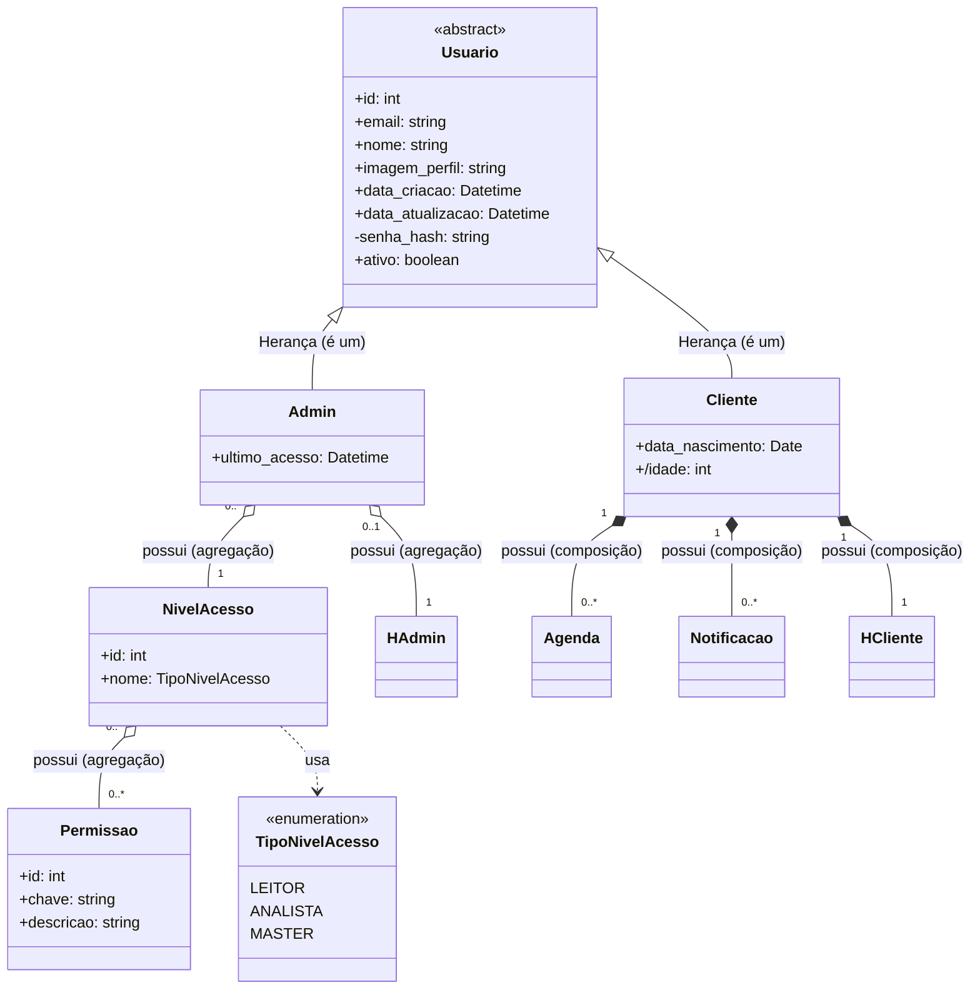

# 👤 Modelagem UML do domínio de Usuário:

<br>

## Descrição Geral
O Domínio de Usuário representa os atores que interagem com a plataforma, estruturado por meio de herança e controle de acesso baseado em papéis e permissões granulares.

<br>

## Classes de domínio:
- **Usuário**(ABC): classe Abstrata base;
- **Cliente**(Usuario): classe concreta que herda de Usuario;
- **Admin**(Usuario): classe concreta que herda de Usuario;
- **Permissao**: classe para modelar as permissões existentes no sistema;
- **NivelAcesso**: classe para modelar os níveis de acesso e suas respectivas permissões;

<br>

## Relações e Regras de Negócio

### Usuario:
Responsável por agrupar os atributos e comportamentos comuns ao domínio de Usuário.
- Classe abstrata, especializada por `Cliente` e `Admin`.
- Usuários inativos não podem realizar alterações no sistema.

### Cliente:
Representa os usuários finais do sistema, aqueles utilizarão o aplicativo como produto, gerenciando entidades e organizando sua rotina através de `Agendas`, `Quadros`, `Tarefas`, `Lembretes` e `Alertas`.
- Quando inativo, pode ter sua conta removida após certo período de tempo
- Idade é um atributo derivado, obtido a partir da data de nascimento
- Um `Cliente` possui 0 ou N `Agendas`, mas uma `Agenda` possui um único `Cliente`.
- Um `Cliente` possui 0 ou N `Notificacoes`, mas uma `Notificacao` está relacionada a um único `Cliente`.
- Um `Cliente` possui um único `HCliente` e um `HCliente` está relacionado a um único `Cliente`.
- A exclusão de um `Cliente` remove em cascata suas `Agendas`, `Lembretes` e Histórico (`HCliente`)

### Admin:
O moderador da plataforma, responsável por fazer o acompanhamento do estado do sistema, mediante consultas de métricas e dados estatísticos. Além de realizar o autogerenciamento de seu próprio domínio, através dos níveis de acesso.
- Quando inativo, perde acesso a todas as permissões do sistema.
- Apenas o `Admin` com nível de acesso MASTER pode tornar outros `Admins` Inativos.
- Um `Admin` possui um único `NivelAcesso`, mas um `NivelAcesso` pode estar relacionado a 0 ou N `Admins`.
- Um `Admin` só pode acessar funcionalidades cujas permissões estejam associadas ao seu nível de acesso.
- O Histórico de `Admin` (`HAdmin`) é persistido mesmo depois que o `Admin` foi removido.

### NivelAcesso:
Modela o nível de acesso de um `Admin`, associando-o às suas respectivas permissões.
- Está relacionado a 0 ou N `Admins`, mas um `Admin` possui apenas um `NivelAcesso`.
- Persistido como tabela física (relacionada 1:N com Admin e N:N com Permissao). Para otimizar a consulta de autorização (@require_permission), sua coleção de permissões é carregada pelo repositório a partir de uma View consolidada no banco de dados.
- Usa a Enumeração `TipoNivelAcesso`.
- Possui relacionamento N:N com `Permissao`.
- Os níveis de acesso a seguir são acumulativos, níveis superiores englobam as permissões de níveis inferiores
- **LEITOR:**
  - Possui apenas permissões de consulta de métricas.
  - Não possui acesso aos históricos.
- **ANALISTA:**
  - Permissões de LEITOR.
  - Pode consultar históricos de Admins (`HAdmin`).
- **MASTER:**
  - Permissões de ANALISTA.
  - Pode gerenciar admins: Adicionar, promover, rebaixar, remover, inativar e reativar.

### Permissao:
Modela as permissões referentes às funcionalidades do sistema, do lado de `Admin`.
- Possui relacionamento de agregação N:N com `NivelAcesso`.

## Modelagem UML:


<br>

## Implementação da validação de acesso de Admin:
Utilizará três decorators:

**@auth_token** (Autenticação e Estado):
- Valida a assinatura e expiração do token JWT.
- Extrai o identificador imutável (`admin.id`) e o `admin.email` do payload e os injeta em `request.state`.

**@require_permission(chave_permissao)** (Autorização e Integridade):
- Realiza consulta otimizada no banco (ou cache) pelo `request.state.admin_id`, trazendo o status ativo, o `NivelAcesso` e as chaves de `Permissao` associadas.
- Verifica se `admin.ativo == True` (bloqueando imediatamente administradores suspensos com token ainda válido) e se `chave_permissao` está presente no nível de acesso.
- Injeta `request.state.nivel_acesso_nome`, `admin.nome` e `request.state.permissao_chave` para uso posterior sem necessidade de novas consultas.

**@log_register** (Auditoria Pós-Execução):
- Executa a função da rota primeiro (`await func(*args, **kwargs)`).
- Caso a operação seja concluída com sucesso, lê `admin.id`, `admin.email`, `nivel_acesso_nome` e `permissao_chave` diretamente do `request.state` e persiste o registro de auditoria no banco de dados.

<br>

### Fluxo sugerido para os decorators:
```python
@router.post("/admin/suspender")
@auth_token
@require_permission("admin.suspender")
@log_register
async def suspender_usuario(request: Request, id: int):
	...
```
